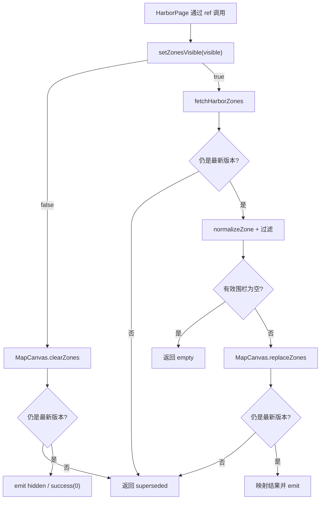

# HarborMap - Vue 电子围栏地图组件

## 模块概述

`HarborMap` 是 `apps/harbor-system` 内负责港区地图与电子围栏编排的 Vue 3 组件模块。组件自身不实现地图绘制，也不决定页面复选框状态；它通过 `fetchHarborZones()` 获取围栏 DTO，经 `normalizeZone()` 转为共享地图模型，再调用 `MapCanvasExpose` 完成替换或清除。

模块对父组件公开 `setZonesVisible(visible)`，这是当前代码中控制电子围栏显隐的唯一公开入口。父页面 `HarborPage.vue` 通过模板 ref 调用该方法，并根据返回结果维护页面状态。

模块类型为 `component`，复杂度判定为 `complex`：虽然源码规模较小，但运行时职责跨越 Vue 组件、公开类型、请求服务、数据适配、共享地图契约与异步并发控制，且模块目录内超过 3 个实现/测试文件。

## AI 快速接手

### 修改前必读

1. `apps/harbor-system/src/components/harbor-map/HarborMap.vue`
   - 查看 props、emits、slot、expose 和 `requestVersion` 并发策略。
   - 电子围栏显隐的主流程全部从 `setZonesVisible()` 进入。
2. `apps/harbor-system/src/components/harbor-map/types.ts`
   - 查看 API DTO、公开返回联合类型和父组件持有的 expose 类型。
3. `apps/harbor-system/src/components/harbor-map/adapters/normalize-zone.ts`
   - 查看围栏启用条件、点串解析和无效数据过滤规则。
4. `packages/shared-ui/src/map-canvas/public.ts`
   - 查看 `replaceZones()`、`clearZones()` 和地图命令结果；这是模块外部依赖契约。
5. `apps/harbor-system/src/components/harbor-map/__tests__/HarborMap.spec.ts`
   - 查看当前已有证明点，不要把未覆盖分支写成已验证行为。

### 完整相关文件

| 角色 | 文件 | 边界归属 | 用途 |
| --- | --- | --- | --- |
| 组件入口 | `apps/harbor-system/src/components/harbor-map/HarborMap.vue` | 模块内 | 公开契约、请求/转换/渲染编排、并发版本控制 |
| 公开与内部类型 | `apps/harbor-system/src/components/harbor-map/types.ts` | 模块内 | `HarborZoneDto`、`HarborZoneResult`、`HarborMapExpose` |
| 数据适配器 | `apps/harbor-system/src/components/harbor-map/adapters/normalize-zone.ts` | 模块内 | 将接口 DTO 转成 `MapZoneModel`，过滤无效围栏 |
| 请求服务 | `apps/harbor-system/src/components/harbor-map/services/harbor-api.ts` | 模块内 | 暴露 `fetchHarborZones()` 请求边界 |
| 组件测试 | `apps/harbor-system/src/components/harbor-map/__tests__/HarborMap.spec.ts` | 验证边界 | 验证部分公开契约、隐藏路径和并发请求 |
| 页面调用方 | `apps/harbor-system/src/pages/HarborPage.vue` | 模块外、下游 | 通过 ref 调用公开方法并维护复选框状态 |
| 地图公开契约 | `packages/shared-ui/src/map-canvas/public.ts` | 模块外、上游 | 提供地图围栏模型及清除/替换命令契约 |

### 常见修改入口

| 修改目标 | 首要入口 | 同步检查 |
| --- | --- | --- |
| 新增或调整组件公开能力 | `HarborMap.vue`、`types.ts` | `HarborPage.vue`、组件测试 |
| 调整接口字段或成功码 | `services/harbor-api.ts`、`types.ts` | `normalize-zone.ts`、显示分支测试 |
| 调整围栏有效性或坐标解析 | `normalize-zone.ts` | `MapZoneModel` 契约、适配器/组件测试 |
| 调整显示、隐藏或并发行为 | `HarborMap.vue` | 所有结果状态、emit 时机、页面回退逻辑 |
| 调整地图命令 | `packages/shared-ui/src/map-canvas/public.ts` | `HarborMap.vue`、MapCanvas 实现及组件 stub |

### 风险摘要

- [代码确认] `requestVersion` 可阻止旧的显示请求在新请求之后调用 `replaceZones()`，但无法撤销已经开始的地图副作用。
- [代码确认] 显示分支把请求、转换与渲染放在同一 `try/catch` 内；`replaceZones()` 抛错时返回 `request-error`，与返回 `{ status: 'render-error' }` 的路径不同。
- [代码确认] 全部 DTO 被过滤后返回 `empty`，不触发 `zoneStatusChange`。
- [待确认] fixture 没有项目级 `package.json`、workspace 配置或测试配置，无法从仓库文件确认完整可执行脚本。

### 推荐验证

```powershell
pnpm exec vitest run apps/harbor-system/src/components/harbor-map/__tests__/HarborMap.spec.ts
```

该命令是基于现有 Vitest 测试文件给出的推荐命令；本次文档生成未声称其已在当前 fixture 中执行成功。

## AI 修改守则

1. 保持运行时边界清晰：页面调用方和共享地图包不是 `harbor-map` 的内部实现，修改它们属于跨模块变更。
2. 修改 `setZonesVisible()` 时同时维护 `HarborZoneResult`、`zoneStatusChange` 语义和 `HarborPage.vue` 的失败回退逻辑。
3. 不要只根据方法返回值判断 UI 事件：当前部分结果不会 emit，例如 `empty`、`superseded` 和 MapCanvas ref 缺失时的 `render-error`。
4. 修改 DTO 或解析规则时，不要直接把接口对象传给 MapCanvas；保持 `normalizeZone()` 作为接口模型到共享 UI 模型的适配边界。
5. 并发修改必须分别考虑“返回结果是否过期”和“地图副作用是否已经发生”，两者不是同一问题。
6. 新增错误状态时应同步检查：联合类型、组件实现、父页面消费、事件负载和测试断言。
7. 不要把 `enabled === '0'` 解释为业务上的启用或禁用含义；代码只确认该值会被保留。

### 完整风险点

- [代码确认] `mapCanvasRef.value` 为空时直接返回 `{ status: 'render-error' }`，不会发出 `zoneStatusChange: error`。
- [代码确认] 隐藏命令先调用 `clearZones()`，之后才检查 `requestVersion`。若期间出现更新命令，旧调用可返回 `superseded`，但清除副作用已经发生。
- [代码确认] 显示命令在 fetch 后、replace 后检查版本，可阻止过期 fetch 结果进入地图，也可抑制过期 replace 的结果和事件；但不能撤销已经完成的 replace。
- [代码确认] 非 200 响应映射为 `request-error` 并 emit `error`。
- [代码确认] `normalizeZone()` 过滤后的数组为空时返回 `empty`，不会调用 `replaceZones()`，也不会 emit 状态。
- [代码确认] `replaceZones()` 返回 `empty` 时，组件 emit `error`，但方法返回 `empty`。
- [代码确认] `replaceZones()` 抛异常时进入统一 catch 并返回 `request-error`，不是 `render-error`。
- [代码确认] `normalizeZone()` 使用 `_` 分隔点、`,` 分隔坐标，只保留有限数值的二元点，少于 3 个有效点时丢弃整条围栏。
- [测试验证] 现有测试只证明两个并发显示请求中，较旧 fetch 结果不会调用 `replaceZones()`；没有证明显示/隐藏交错时的最终地图状态。
- [待确认] `enabled: '0'` 被视为可渲染记录的业务原因未在 fixture 内说明。

## 模块边界

### 运行时内部边界

以下文件共同构成 `harbor-map` 的运行时模块：

- `apps/harbor-system/src/components/harbor-map/HarborMap.vue`
- `apps/harbor-system/src/components/harbor-map/types.ts`
- `apps/harbor-system/src/components/harbor-map/services/harbor-api.ts`
- `apps/harbor-system/src/components/harbor-map/adapters/normalize-zone.ts`

边界内职责包括：

- 提供港区地图组件及其 Vue 公开契约。
- 请求电子围栏 DTO。
- 将 DTO 转换为共享地图组件接受的模型。
- 编排地图围栏清除与替换。
- 使用请求版本号抑制部分过期异步结果。

### 验证边界

`apps/harbor-system/src/components/harbor-map/__tests__/HarborMap.spec.ts` 属于模块的验证资产，不参与生产运行时。它通过 MapCanvas stub 和 API mock 验证组件行为。

### 明确排除项

- `apps/harbor-system/src/pages/HarborPage.vue` 是已确认的下游消费者。它决定复选框交互和失败后的页面状态，不是 HarborMap 的内部实现。
- `packages/shared-ui/src/map-canvas/public.ts` 是上游共享契约。它定义 HarborMap 可以调用的地图能力，不属于 HarborMap 模块。
- MapCanvas 的真实绘制实现未出现在 fixture 中，不能把渲染细节归入本模块。
- 港区围栏 API 的真实传输实现未出现在 fixture 中；当前 `fetchHarborZones()` 是模块内请求边界，其函数体返回固定空数据。

### 边界判定结论

现有 owner 文档把 `HarborPage.vue` 的失败回退描述混入了模块实现，并把共享地图契约与模块内部边界并列。正确边界应按“内部实现、下游消费者、上游依赖、测试资产”分层，避免修改 HarborMap 时误判所有权。

## 当前实现契约

### Props

| 名称 | 类型 | 默认值 | 作用 |
| --- | --- | --- | --- |
| `initialZoom` | `number \| undefined` | `12` | 透传给 `MapCanvas` 的 `initial-zoom` |

### Emits

| 事件 | 负载 | 已确认触发条件 |
| --- | --- | --- |
| `zoneStatusChange` | `'visible'` | 围栏替换成功，且当前调用仍为最新版本 |
| `zoneStatusChange` | `'hidden'` | 围栏清除成功，且当前调用仍为最新版本 |
| `zoneStatusChange` | `'error'` | 清除异常、非 200 响应、地图命令返回非 success，或显示流程捕获异常且调用未过期 |

事件不会覆盖所有返回状态：`empty`、`superseded` 和 MapCanvas ref 缺失的 `render-error` 路径不一定触发事件。

### Slots

| 名称 | Slot props | 渲染位置 |
| --- | --- | --- |
| `toolbar` | 无 | `.harbor-map` section 内、MapCanvas 之前 |

默认 slot 未暴露。

### Expose

```ts
interface HarborMapExpose {
  setZonesVisible(visible: boolean): Promise<HarborZoneResult>
}
```

`setZonesVisible()` 是当前唯一 expose 方法，也是电子围栏显隐的公开命令入口。

### 返回结果

| 结果 | 含义（按代码） | count |
| --- | --- | --- |
| `{ status: 'success', count }` | 地图命令成功；隐藏时 count 固定为 0 | 有 |
| `{ status: 'empty' }` | 没有有效 DTO，或地图替换返回 empty | 无 |
| `{ status: 'request-error' }` | 非 200 响应，或显示流程捕获异常 | 无 |
| `{ status: 'render-error' }` | MapCanvas ref 不存在、清除抛错，或地图替换返回 render-error | 无 |
| `{ status: 'superseded' }` | 异步完成时发现已有更新调用 | 无 |

### 服务与适配器契约

```ts
fetchHarborZones(): Promise<{ code: number; data: HarborZoneDto[] }>
normalizeZone(dto: HarborZoneDto): MapZoneModel | null
```

`HarborZoneDto` 字段为 `zone_id`、`enabled`、`points`。适配器只输出具有非空 id、`enabled === '0'` 且至少有 3 个有效坐标点的模型。

## 电子围栏入口

### 对外入口

父组件通过模板 ref 获取 `HarborMapExpose`，调用：

```ts
await harborMapRef.value?.setZonesVisible(checked)
```

在 fixture 中，确认调用方为 `apps/harbor-system/src/pages/HarborPage.vue`。该页面把 `status === 'success'` 作为复选框保持目标状态的条件；其他状态会回退为未选中。

### 显示入口：`setZonesVisible(true)`

1. 增加 `requestVersion`，记录本次调用版本。
2. 确认 MapCanvas ref 已就绪；否则返回 `render-error`。
3. 调用 `fetchHarborZones()`。
4. 在请求返回后检查版本；过期则返回 `superseded`。
5. 非 200 响应 emit `error`，返回 `request-error`。
6. 使用 `normalizeZone()` 转换并过滤 DTO。
7. 没有有效围栏时返回 `empty`。
8. 调用 `mapCanvas.replaceZones(zones)`。
9. 在地图命令完成后再次检查版本；过期则返回 `superseded`。
10. 地图命令成功时 emit `visible`，返回 success/count；其他返回值映射为 `empty` 或 `render-error`，并 emit `error`。

### 隐藏入口：`setZonesVisible(false)`

1. 增加 `requestVersion`。
2. 调用 `mapCanvas.clearZones()`，不会请求围栏 API。
3. 清除完成后检查版本；过期则返回 `superseded`。
4. 成功时 emit `hidden` 并返回 `{ status: 'success', count: 0 }`。
5. 清除异常时 emit `error` 并返回 `render-error`。

### 内部扩展入口

- 请求协议变化：`services/harbor-api.ts` 与 `types.ts`。
- 数据格式变化：`adapters/normalize-zone.ts`。
- 地图命令变化：`HarborMap.vue` 与 `packages/shared-ui/src/map-canvas/public.ts`。
- 页面交互变化：`HarborPage.vue`，属于下游而非模块内部。

## 核心流程



- 页面只接触 expose 契约，不直接调用 API、适配器或 MapCanvas。
- 显示路径在 API 返回后才执行 DTO 转换，可阻止过期请求覆盖较新显示请求。
- 版本检查发生在地图命令之后时，只能抑制返回值和事件，不能回滚地图副作用。
- 隐藏路径与显示路径共用同一个版本计数器。

## 依赖关系

### 运行时依赖

| 依赖 | 方向 | 使用点 | 契约 |
| --- | --- | --- | --- |
| `vue` | 外部依赖 | `HarborMap.vue` | `ref`、props、emits、expose、slot |
| `@shared/ui/map-canvas` | 上游共享组件 | `HarborMap.vue` | MapCanvas 组件渲染 |
| `@shared/ui/map-canvas/public` | 上游共享类型 | `HarborMap.vue`、`normalize-zone.ts` | `MapCanvasExpose`、`MapZoneModel` |
| `./services/harbor-api` | 模块内 | `HarborMap.vue` | `fetchHarborZones()` |
| `./adapters/normalize-zone` | 模块内 | `HarborMap.vue` | `normalizeZone()` |
| `./types` | 模块内 | 多文件 | DTO、返回结果和 expose 类型 |

### 下游消费者

| 消费者 | 状态 | 消费内容 |
| --- | --- | --- |
| `apps/harbor-system/src/pages/HarborPage.vue` | confirmed | `HarborMap` 组件、`HarborMapExpose`、`setZonesVisible()` 返回状态 |

fixture 中未发现其他调用方。该结论只覆盖提供的 fixture 文件集合。

## 影响范围

| 修改类型 | 影响文件 | 风险 | 建议验证 |
| --- | --- | --- | --- |
| 修改 props 默认值或名称 | `HarborMap.vue`、调用模板 | 页面显示差异、类型不兼容 | props 与 MapCanvas 透传测试 |
| 修改 emit 名称/负载/时机 | `HarborMap.vue`、潜在监听方 | UI 状态不同步 | 各成功/失败/空数据事件断言 |
| 修改 expose 或返回联合类型 | `HarborMap.vue`、`types.ts`、`HarborPage.vue` | 父页面编译失败或回退错误 | 类型检查、页面消费测试 |
| 修改 API 响应字段或状态码 | `harbor-api.ts`、`types.ts`、`HarborMap.vue` | 请求结果误分类 | 非 200、空数据、异常测试 |
| 修改坐标解析规则 | `normalize-zone.ts`、地图模型 | 围栏被误过滤或错误绘制 | 独立适配器边界用例、组件显示测试 |
| 修改并发策略 | `HarborMap.vue` | 旧请求覆盖新请求、清除/替换竞态 | 显示-显示、显示-隐藏、隐藏-显示交错测试 |
| 修改 MapCanvas 契约 | 共享 UI public、HarborMap、测试 stub | 跨包破坏性变更 | 共享包类型检查与组件集成测试 |
| 修改页面失败回退 | `HarborPage.vue` | checkbox 与地图状态不一致 | 页面级交互测试 |

## 已验证行为

### 测试文件

- `apps/harbor-system/src/components/harbor-map/__tests__/HarborMap.spec.ts`

### 代码内已有测试证明点

- [测试验证] 调用 `setZonesVisible(false)` 不请求 `fetchHarborZones()`，会调用一次 `clearZones()`，并返回 `{ status: 'success', count: 0 }`。
- [测试验证] 两个连续显示请求中，较新的请求先完成时会成功替换围栏；较旧请求随后完成返回 `superseded`，`replaceZones()` 总计只调用一次。
- [测试验证] `initialZoom` prop 可由父组件传入。
- [测试验证] `toolbar` 命名 slot 可渲染内容。
- [测试验证] `setZonesVisible` 通过 expose 可调用。
- [测试验证] 隐藏成功后发出 `zoneStatusChange`，负载为 `hidden`。

### 当前未覆盖的验证范围

- 未验证 `initialZoom` 默认值 `12` 是否透传给真实 MapCanvas。
- 未验证显示成功后的 `visible` 事件及 count 透传。
- 未验证非 200 响应、请求抛错和 MapCanvas ref 缺失。
- 未验证 DTO 全部无效、有效/无效 DTO 混合及 `normalizeZone()` 的各过滤条件。
- 未验证 `replaceZones()` 返回 `empty`、返回 `render-error` 或抛异常的差异。
- 未验证 `clearZones()` 抛异常。
- 未验证显示与隐藏交错调用造成的地图副作用竞态。
- 未使用真实 MapCanvas；现有测试通过 stub 只验证 HarborMap 与 expose 契约的交互。
- 未发现 `HarborPage.vue` 的页面级测试，复选框失败回退仅由代码确认。

### 验证命令

推荐在完整仓库依赖和测试配置可用时运行：

```powershell
pnpm exec vitest run apps/harbor-system/src/components/harbor-map/__tests__/HarborMap.spec.ts
```

[待确认] 提供的 fixture 未包含 package/workspace/test 配置，因此本次分析无法确认该命令在 fixture 根目录可直接执行，也没有把测试文件的历史结果当作本次已运行结果。

## 修改指南

### 新增电子围栏结果状态

1. 在 `types.ts` 扩展 `HarborZoneResult`。
2. 在 `HarborMap.vue` 明确该状态对应的返回路径和 emit 策略。
3. 检查 `HarborPage.vue` 是否仍应只把 `success` 视为选中成功。
4. 扩展 `HarborMap.spec.ts`，覆盖返回值和事件。

### 修改接口或 DTO

1. 在 `harbor-api.ts` 调整 API 返回契约。
2. 在 `types.ts` 调整 `HarborZoneDto`。
3. 在 `normalize-zone.ts` 维护边界转换，不把后端字段泄漏给共享地图模型。
4. 为有效、无效和混合数据增加适配器测试。

### 修改并发行为

1. 明确目标是“最新调用获胜”还是“最新可执行副作用获胜”。
2. 分别测试显示-显示、显示-隐藏、隐藏-显示。
3. 对每种交错同时断言方法结果、事件序列和 MapCanvas 调用顺序。
4. 若需要撤销或取消副作用，应引入可取消请求/命令或在执行地图命令前完成版本判定，不能只依赖事后版本检查。

### 修改模块边界

如果将 API、适配器或地图协调逻辑迁出目录，应同步更新 imports、测试 mock 路径和本文档。不要因页面是唯一调用方就把 `HarborPage.vue` 并入模块内部；它拥有独立的页面交互职责。

## 问题排查路径

### 复选框勾选后没有围栏

1. 检查 `HarborPage.vue` 是否取得 `harborMapRef`，并确认 `setZonesVisible(true)` 的返回状态。
2. 若为 `request-error`，检查 `fetchHarborZones()` 是否抛错或返回非 200；同时注意渲染抛错当前也可能落入此状态。
3. 若为 `empty`，检查响应是否为空、DTO 是否被 `normalizeZone()` 全部过滤，或 MapCanvas 是否返回 empty。
4. 若为 `render-error`，检查 MapCanvas ref 是否就绪，以及 `replaceZones()` 的返回值。
5. 若为 `superseded`，检查是否有后续显示/隐藏调用增加了 `requestVersion`。

### 围栏显示了但页面复选框回退

1. 检查方法是否在 `replaceZones()` 完成后因版本变化返回 `superseded`。
2. 检查页面逻辑：只有 `status === 'success'` 才保持传入 checked，其余状态均回退未选中。
3. 检查是否存在地图副作用已完成但结果因并发被判定过期的情况。

### 围栏数据被意外丢弃

1. 检查 `zone_id.trim()` 是否为空。
2. 检查 `enabled` 是否严格等于字符串 `'0'`。
3. 检查 `points` 是否以 `_` 分点、以 `,` 分坐标。
4. 检查过滤非有限数值后是否仍至少有 3 个点。

### 隐藏后围栏又出现或显示后被清空

检查显示和隐藏请求的交错顺序。`requestVersion` 会改变返回结果和事件，但 `clearZones()` 或 `replaceZones()` 一旦开始执行，其副作用不会被版本号撤销。

## 待确认项

- [待确认] `enabled === '0'` 代表可显示围栏的业务语义，还是 fixture 中的临时协议约定。
- [待确认] `fetchHarborZones()` 当前固定返回 `{ code: 200, data: [] }`；真实请求实例、端点、鉴权、超时和取消机制未提供。
- [待确认] MapCanvas 的真实实现未提供，无法确认替换/清除命令是否幂等、是否支持取消，以及渲染副作用的时序。
- [待确认] `empty` 是否应发出 `zoneStatusChange`，以及负载应为 `hidden` 还是新增状态。
- [待确认] MapCanvas ref 缺失时是否应 emit `error`；当前只返回 `render-error`。
- [待确认] `replaceZones()` 抛异常应归类为 `request-error` 还是 `render-error`；当前代码归类为前者。
- [待确认] 页面是否需要区分 `request-error`、`render-error`、`empty` 和 `superseded`；当前全部回退为未选中。
- [待确认] 完整仓库中的实际 pnpm 脚本、tsconfig 和 Vitest 配置未包含在 fixture 内。

## 文档维护信息

- 文档格式：`ai-module-spec v2`
- 分析日期：2026-08-08
- 分析范围：用户提供 fixture 中的 `apps/harbor-system/src/components/harbor-map`，以及 fixture 内直接导入方、上游公开契约和现有 owner 文档
- 事实标签：代码可直接确认的内容不额外标注；测试证明点使用 `[测试验证]`；业务语义或缺失上下文使用 `[待确认]`
- 索引更新：无。用户指定独立输出路径，本次未修改 fixture 内 `claudedocs` 或其他索引文件
- 迁移处理：无。fixture 内已有 owner 模块文档仅作为边界污染与契约遗漏的基线证据，未迁移、覆盖或修改

