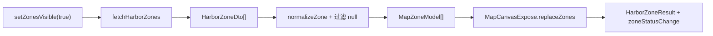

# HarborMap - 港区电子围栏地图组件

## 模块概述

HarborMap 是 `apps/harbor-system` 内负责港区电子围栏显隐编排的 Vue 组件。模块通过 expose 命令接收显隐意图：显示时读取围栏 DTO、转换为共享地图模型并替换地图图层；隐藏时清除图层。调用结果通过 `HarborZoneResult` 返回，稳定的可见、隐藏或错误状态同时通过组件事件通知。

## 模块边界

### 模块拥有的文件

| 路径 | 角色 | 当前职责 |
| --- | --- | --- |
| `apps/harbor-system/src/components/harbor-map/HarborMap.vue` | owned | Vue 公开契约、显隐命令编排、请求版本控制、地图命令调用和事件通知 |
| `apps/harbor-system/src/components/harbor-map/types.ts` | owned | 围栏 DTO、命令结果与 expose 接口 |
| `apps/harbor-system/src/components/harbor-map/services/harbor-api.ts` | owned | `fetchHarborZones()` 服务入口及响应类型；当前实现返回 `code: 200` 的空数据集合 |
| `apps/harbor-system/src/components/harbor-map/adapters/normalize-zone.ts` | owned | 将港区围栏 DTO 转换为共享地图围栏模型 |
| `apps/harbor-system/src/components/harbor-map/__tests__/HarborMap.spec.ts` | owned | 模块内部组件验证入口 |

### 边界外文件

- `packages/shared-ui/src/map-canvas/public.ts` 是模块真实使用的直接公共依赖，只纳入 HarborMap 使用的最小公开契约，不归 HarborMap 所有。
- `apps/harbor-system/src/pages/HarborPage.vue` 属于页面调用方，无条件排除；页面内部状态与测试不属于 HarborMap 模块事实。

边界结论明确，无需引入目标目录外的专属实现文件，也不存在需要用户确认的共享所有权冲突。

## 功能目录

### 电子围栏显隐编排

入口为 `HarborMap.vue#setZonesVisible(visible)`。

- `visible` 为 `false` 时，模块调用 `MapCanvasExpose.clearZones()`；成功返回 `{ status: 'success', count: 0 }` 并发出 `zoneStatusChange: 'hidden'`。
- `visible` 为 `true` 时，模块调用 `fetchHarborZones()`。响应 `code` 非 `200` 时返回 `request-error` 并发出 `error`。
- 有效围栏经过规范化后交给 `MapCanvasExpose.replaceZones()`；地图替换成功时返回共享命令给出的数量并发出 `visible`。
- 地图引用不可用或清除失败时返回 `render-error`。`replaceZones()` 以结果对象返回 `render-error` 时也映射为 `render-error`；显示链路中抛出的异常统一由外层 catch 映射为 `request-error`，除非该调用已经过期。
- 规范化后没有可渲染围栏时返回 `empty`，不调用 `replaceZones()`。

### 围栏数据规范化

入口为 `normalize-zone.ts#normalizeZone`。

- 只有 `enabled === '0'` 且去除首尾空白后的 `zone_id` 非空的 DTO 才继续转换。
- `points` 先按 `_` 拆分点，再按 `,` 拆分坐标并转为数字；非二元组或含非有限数字的点会被丢弃。
- 有效坐标少于 3 个时返回 `null`；其余数据转换为 `{ id, coordinates }` 的 `MapZoneModel`。
- `HarborMap.vue` 会过滤 `null`，因此共享地图组件只接收符合上述最小结构的围栏。

### 并发请求淘汰

`setZonesVisible()` 每次调用都会递增模块内的 `requestVersion`。围栏查询返回、地图清除成功或地图替换返回后，若当前版本已不是最新版本，命令返回 `{ status: 'superseded' }`，不再把过期结果通知为可见或隐藏。

显示链路的统一 catch 也会先比较版本；已经过期的请求返回 `superseded`，不会覆盖为 `request-error`。隐藏链路的 `clearZones()` 异常分支没有再次比较版本，会直接发出 `error` 并返回 `render-error`。

## 当前公开契约

### Props

| 名称 | 类型 | 默认值 | 语义 |
| --- | --- | --- | --- |
| `initialZoom` | `number?` | `12` | 透传给内部 `MapCanvas` 的初始缩放级别 |

### Emits

| 名称 | 载荷 | 触发语义 |
| --- | --- | --- |
| `zoneStatusChange` | `'visible' \| 'hidden' \| 'error'` | 地图替换成功、清除成功，或当前非过期命令发生请求/渲染错误时触发 |

`empty` 与 `superseded` 没有对应事件；调用者需要从 expose 命令的返回值区分这两种结果。

### Slots

| 名称 | Slot props | 位置 |
| --- | --- | --- |
| `toolbar` | 无 | 位于地图画布之前，用于注入工具栏内容 |

默认 slot：无。

### Expose

电子围栏的公开入口是：

```ts
setZonesVisible(visible: boolean): Promise<HarborZoneResult>
```

返回类型为：

```ts
type HarborZoneResult =
  | { status: 'success'; count: number }
  | { status: 'empty' }
  | { status: 'request-error' }
  | { status: 'render-error' }
  | { status: 'superseded' }
```

除 `setZonesVisible` 外无其他 expose 项。

## 直接公共依赖

### `@shared/ui/map-canvas`

模块使用默认导出的 `MapCanvas` 组件，并从 `packages/shared-ui/src/map-canvas/public.ts` 使用以下最小公开契约：

- `MapZoneModel`：`id: string` 与 `coordinates: Array<[number, number]>`。
- `MapCanvasExpose.replaceZones(zones)`：接收规范化围栏数组，返回 `success`、`empty` 或 `render-error` 结果。
- `MapCanvasExpose.clearZones()`：清除围栏，返回 `Promise<void>`。

HarborMap 将 `initialZoom` 传给内部 `MapCanvas`，但不拥有共享组件的 prop 定义、地图渲染实现或内部错误处理。

## 数据流与责任分层



- 服务层负责提供 `{ code, data }` 响应，不解释地图模型。
- 适配器负责字段筛选、坐标解析和 DTO 到 `MapZoneModel` 的语义转换。
- 组件负责异步编排、最新请求判定、共享地图命令结果映射与公开通知。
- 共享地图组件负责实际替换或清除围栏；其内部渲染过程不进入 HarborMap 文档边界。

隐藏链路不经过服务和适配器，直接从 `setZonesVisible(false)` 到 `clearZones()`。

## 跨功能不变量与风险

- 最新调用优先覆盖成功返回与显示链路异常：查询、清除成功、替换结果和显示链路 catch 在形成公开结果前比较 `requestVersion`。
- 隐藏链路存在并发例外：过期调用的 `clearZones()` 若抛出异常，仍会发出 `error` 并返回 `render-error`。
- 请求错误与渲染错误按返回形态分层：非 `200` 响应映射为 `request-error`；地图引用缺失、清除异常和地图返回的渲染失败映射为 `render-error`。显示链路中抛出的异常统一映射为 `request-error`，其中也包括 `replaceZones()` 的 rejection。
- 事件只表达稳定的可见、隐藏或错误通知；`empty` 和 `superseded` 只通过返回值表达。
- 空集合不会进入地图替换；只有至少一个规范化成功的围栏才调用 `replaceZones()`。

## 验证入口与证明范围

| 改动层级 | 检查入口 | 检查类型 | 能证明 | 不能证明 | 扩大条件 |
| --- | --- | --- | --- | --- | --- |
| 组件公开契约、显隐编排与结果映射 | `apps/harbor-system/src/components/harbor-map/__tests__/HarborMap.spec.ts` | 组件测试 | 该文件中显式覆盖的 props、slot、expose 命令、事件、异步分支和共享地图 mock 交互 | 真实后端响应、共享地图内部渲染、页面调用方状态与浏览器视觉效果 | 修改服务传输、共享地图公开契约、页面集成或视觉布局时增加对应层级验证 |
| DTO 到地图模型转换 | `apps/harbor-system/src/components/harbor-map/adapters/normalize-zone.ts` 及其调用链 | 单元/组件边界 | 通过直接单元用例或组件输入覆盖时，可证明启用值、ID、坐标拆分、有限数字和最少点数规则 | 坐标业务含义、地图投影正确性和服务端数据质量 | 修改点串格式、启用语义或 `MapZoneModel` 时增加适配器边界用例 |
| TypeScript 公开类型 | `apps/harbor-system/src/components/harbor-map/types.ts` 与 `packages/shared-ui/src/map-canvas/public.ts` | 类型检查 | expose 返回联合类型与共享地图公开类型之间的静态兼容关系 | 运行时网络、并发时序和地图绘制结果 | 任一公开类型、路径别名或跨 owner 契约变化时执行 owner 与共享库类型检查 |

验证入口描述长期证明能力，不代表任何一次执行结论。当前 fixture 未提供 owner 的脚本清单，因此本文档不虚构具体测试、类型检查或 lint 命令。

## 文档维护信息

- 事实入口：`apps/harbor-system/src/components/harbor-map/` 内生产代码与内部测试入口。
- 直接依赖声明：`packages/shared-ui/src/map-canvas/public.ts`。
- 更新时继续排除页面调用方实现；共享地图只记录 HarborMap 真实使用的最小公开契约。
- 公开契约变更时完整复核 Props、Emits、Slots、Expose 四类接口，并同步更新功能索引与验证范围。
