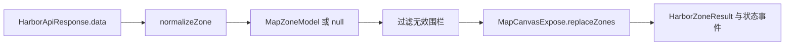

# HarborMap - 电子围栏地图组件

## 模块概述

HarborMap 是 `apps/harbor-system` 内的 Vue 组件模块。它持有 MapCanvas 实例引用，对外暴露电子围栏显隐命令；显示时获取港区围栏 DTO、转换为地图围栏模型并替换地图内容，隐藏时直接清除地图围栏。模块用单调递增的请求版本号，在清理成功、查询完成和地图替换完成后的检查点淘汰较旧操作。

## 模块边界

| 路径 | 角色 | 模块内职责 |
| --- | --- | --- |
| `apps/harbor-system/src/components/harbor-map/HarborMap.vue` | owned | Vue 公开契约、显隐编排、请求版本仲裁、状态事件与 MapCanvas 调用 |
| `apps/harbor-system/src/components/harbor-map/types.ts` | owned | 围栏 DTO、显隐命令结果和组件 Expose 类型 |
| `apps/harbor-system/src/components/harbor-map/adapters/normalize-zone.ts` | owned | 将港区围栏 DTO 规范化为地图围栏模型 |
| `apps/harbor-system/src/components/harbor-map/services/harbor-api.ts` | owned | 提供模块专用的围栏查询入口及响应类型 |
| `apps/harbor-system/src/components/harbor-map/__tests__/HarborMap.spec.ts` | owned | 记录组件契约、隐藏流程和并发仲裁的稳定验证入口 |
| `packages/shared-ui/src/map-canvas/public.ts` | direct-public-dependency | 提供模块实际使用的 `MapCanvasExpose`、`MapZoneModel` 与命令结果公开类型 |

边界不沿组件使用方向扩展。模块外部如何保存开关状态、处理失败或组织页面交互，不属于 HarborMap 当前事实。

## 功能目录

### 电子围栏显隐编排

入口为 `HarborMap.vue#setZonesVisible`。

- 每次调用先递增 `requestVersion` 并读取当前 MapCanvas 实例；实例不存在时返回 `{ status: 'render-error' }`。
- `visible` 为 `false` 时不请求围栏数据，而是调用 `clearZones()`；当前操作仍为最新版本时触发 `zoneStatusChange('hidden')`，并返回成功结果及 `count: 0`。
- `visible` 为 `true` 时依次执行围栏查询、响应码检查、DTO 规范化与空结果检查，再调用 `replaceZones()`。
- 地图替换成功时触发 `zoneStatusChange('visible')`，并把 MapCanvas 返回的数量作为公开结果；请求、清理或绘制失败映射为模块公开状态，并在对应错误分支触发 `zoneStatusChange('error')`。

最短事实链：`setZonesVisible` → `requestVersion` 与 MapCanvas 引用 → `fetchHarborZones` / `normalizeZone` → `clearZones` 或 `replaceZones` → `HarborZoneResult` 与 `zoneStatusChange` → `HarborMap.spec.ts`。

### 围栏数据获取

入口为 `harbor-api.ts#fetchHarborZones`。该异步函数返回 `HarborApiResponse`，结构为数字 `code` 和 `HarborZoneDto[]`。当前实现返回 `code: 200` 与空数组；`setZonesVisible(true)` 仅在 `code === 200` 时继续处理数据，其他响应码映射为 `request-error`。

最短事实链：`fetchHarborZones` → `HarborApiResponse` → `setZonesVisible` 响应码分支 → `HarborZoneResult` → 组件测试中的服务替身入口。

### 围栏数据规范化

入口为 `normalize-zone.ts#normalizeZone`。

- 仅接收 `enabled === '0'` 且去除首尾空白后非空的 `zone_id`。
- `points` 使用 `_` 分隔点、`,` 分隔坐标值，并将坐标转换为有限数字。
- 少于 3 个有效坐标时返回 `null`；有效输入返回 `{ id, coordinates }` 形式的 `MapZoneModel`。
- 显示流程对查询结果逐项转换并过滤 `null`；过滤后为空时返回 `empty`，不会调用 `replaceZones()`。

最短事实链：`HarborZoneDto` → `normalizeZone` → `MapZoneModel | null` → `setZonesVisible` 过滤 → `replaceZones` 或 `empty` → 组件测试中的有效 DTO 路径。

### 最新请求仲裁

入口为 `HarborMap.vue#setZonesVisible`。每次显隐操作获取独立版本号，并在清理完成、查询完成和地图替换完成后与最新 `requestVersion` 比较。已被后续操作取代的流程返回 `{ status: 'superseded' }`，不提交其后续成功结果；组件测试记录了两个乱序完成的显示请求在查询阶段应遵循的最新请求优先预期。

## 当前公开契约

### Props

| 名称 | 类型 | 默认值 | 语义 |
| --- | --- | --- | --- |
| `initialZoom` | `number`，可选 | `12` | 作为 `initial-zoom` 传给 MapCanvas |

### Emits

| 名称 | 载荷 | 触发语义 |
| --- | --- | --- |
| `zoneStatusChange` | `'visible' \| 'hidden' \| 'error'` | 围栏成功显示、成功隐藏，或请求/清理/绘制错误时通知状态 |

`empty`、`superseded` 以及 MapCanvas 不可用的早返回只体现在 Expose 方法结果中，不触发对应成功状态事件。

### Slots

| 名称 | Slot props | 位置 |
| --- | --- | --- |
| `toolbar` | 无 | MapCanvas 之前的组件工具栏区域 |

### Expose

```ts
setZonesVisible(visible: boolean): Promise<HarborZoneResult>
```

`HarborZoneResult` 为以下联合：

- `{ status: 'success'; count: number }`
- `{ status: 'empty' }`
- `{ status: 'request-error' }`
- `{ status: 'render-error' }`
- `{ status: 'superseded' }`

## 直接公共依赖

模块通过 `@shared/ui/map-canvas` 渲染 MapCanvas，并从 `@shared/ui/map-canvas/public` 使用以下最小公开契约：

| 公开 symbol | HarborMap 实际使用 |
| --- | --- |
| `MapCanvasExpose.clearZones()` | 隐藏流程清除已有围栏，返回 `Promise<void>` |
| `MapCanvasExpose.replaceZones(zones)` | 显示流程替换围栏，消费规范化后的 `MapZoneModel[]`，读取 `status` 和成功时的 `count` |
| `MapZoneModel` | 约束规范化结果为 `id` 与二维坐标数组 |
| `MapZoneCommandResult` | 通过 `replaceZones` 返回值间接消费 `success`、`empty`、`render-error` 语义 |

HarborMap 将 MapCanvas 的非成功绘制结果吸收为自身的 `empty` 或 `render-error`，不公开 MapCanvas 的内部实现。

## 数据转换与责任分层



- service 层提供港区 DTO 响应边界。
- adapter 层负责启用标记、标识、坐标解析和最少点数校验，不负责请求或渲染。
- 组件层负责顺序编排、空集合判断、并发仲裁、依赖结果映射和 Vue 公开结果。
- MapCanvas 负责实际围栏清理与替换；HarborMap 只依赖其公开命令契约。

## 跨功能风险

- `requestVersion` 是显示、隐藏、查询和绘制流程共享的最新请求不变量。新增异步阶段时，需要在可能提交结果的位置保持版本检查，否则较旧操作可能覆盖较新意图。
- `normalizeZone` 返回 `null` 的规则直接决定是否进入 `empty` 分支；变更启用标记、坐标分隔或最少点数规则会同时改变 adapter 输出、地图输入和公开结果。
- `MapCanvasExpose` 的状态联合与 HarborMap 的结果映射相互约束；共享公开契约改变时，需要同步核对 `empty`、`render-error` 和成功数量语义。

## 验证入口与证明范围

| 改动层级 | 检查入口 | 检查类型 | 能证明 | 不能证明 | 扩大条件 | 长期前提 |
| --- | --- | --- | --- | --- | --- | --- |
| 组件契约 | `apps/harbor-system/src/components/harbor-map/__tests__/HarborMap.spec.ts` | 组件 | `initialZoom` 可读取、`toolbar` slot 可渲染、`setZonesVisible` 被 expose、成功隐藏会发出 `hidden` | 未覆盖所有事件状态和所有 Expose 返回分支 | Props、Emits、Slots 或 Expose 变化 | Vue Test Utils 与 Vitest 可挂载 script-setup 组件 |
| 隐藏流程 | `apps/harbor-system/src/components/harbor-map/__tests__/HarborMap.spec.ts` | 组件 | 隐藏不调用围栏查询、调用一次 `clearZones` 并返回数量为 0 的成功结果 | 未覆盖 MapCanvas 不可用、清理异常及显示后再隐藏的组合 | 清理命令或隐藏状态映射变化 | MapCanvas stub 按公开 Expose 契约提供 `clearZones` |
| 并发与有效数据路径 | `apps/harbor-system/src/components/harbor-map/__tests__/HarborMap.spec.ts` | 组件 | 两个显示请求乱序完成时，旧查询结果应返回 `superseded`，只有最新有效 DTO 的规范化结果进入地图替换 | 只覆盖一个有效 DTO；未覆盖查询后绘制阶段、显示与隐藏交错、规范化拒绝分支、真实请求、真实地图绘制或错误分支 | 新增异步阶段、修改 `requestVersion` 检查点、DTO 规则或共享地图契约 | 可控制服务 Promise 完成顺序，MapCanvas stub 按公开 Expose 契约返回命令结果 |

模块当前缺少针对 `normalizeZone` 拒绝分支、请求非 200、空数据、MapCanvas 不可用、清理/替换异常，以及显示与隐藏交错竞态的专门测试入口；这些是现有验证范围之外的扩大方向，不代表实现状态。

## 文档维护信息

- 事实 owner：`apps/harbor-system`。
- 主入口：`apps/harbor-system/src/components/harbor-map/HarborMap.vue#setZonesVisible`。
- 更新时先核对 Vue 四类公开契约、`HarborZoneResult` 联合、`requestVersion` 检查点、DTO 规范化规则，以及 `MapCanvasExpose` 的实际使用契约。
- 不把模块使用方的页面状态、失败回退或交互组织写入本模块文档。
